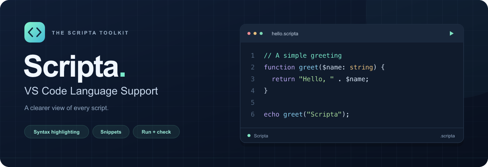

# Scripta VS Code Language Support

VS Code language support for [Scripta](https://github.com/trafficinc/scripta).
Open a `.scripta` file to select **Scripta** automatically. Extensionless scripts are
recognized by a `scripta` shebang. You can also select Scripta from VS Code's
language mode picker. The shorthand `.scta` extension and legacy `scr` shebang
remain supported. The `.scr` extension is no longer associated with Scripta.
Scripts contain plain source code; opening and closing tags are deprecated.

Includes syntax highlighting, line/block comment toggling, bracket matching,
auto-closing quotes and brackets, indentation, and region folding. Strings stay
literal: `$name` inside a string is not interpolation. Double-quoted and
single-quoted strings have different supported escapes, matching Scripta.

When Code Spell Checker is installed, the extension includes `scripta` in its
default accepted words. If you configure `cSpell.words` yourself, include
`scripta` in that list too, since explicit settings override extension defaults.

Snippets: `scripta`, `scriptamain` (also `scr`, `scrmain`), `fn`, `if`, `ifelse`, `foreach`, `foreachkv`, `for`,
`while`, `try`, `echo`, and `require`. Use **Insert Snippet** or completion to
insert one. The script snippets are intended for empty files.

## Basic IntelliSense

Start typing a built-in name, or press **Ctrl+Space**, to see function and keyword
suggestions. After a module prefix such as `String::` or `File::`, suggestions show
that module's functions. Accepting a function inserts a call with editable
placeholders for required arguments; use **Tab** to move between them. Optional
arguments remain visible in the signature and can be added manually. Existing
call parentheses are preserved.

Hover over a built-in name to see its signature and description. The bundled
catalog covers 226 global and module functions, including SQLite and the
request-only Web/Session APIs, whose availability is noted in their descriptions.
Suggestions are suppressed inside strings and comments, after `$` and `->`, and
when naming declarations. Existing snippets remain available.

Completion and hover work in unsaved documents and Restricted Mode without a
Scripta runtime installed. The catalog is static: it does not inspect your runtime
version or project. Project variables, user-defined functions, member completion,
go to definition, and parameter hints while typing a call are not included.

## Install a release

Download the `.vsix` file from the repository's
[Releases page](https://github.com/trafficinc/vscode-scripta/releases).
In VS Code, open **Extensions → ⋯ → Install from VSIX…** and select that file.

## Install locally

To rebuild the package in `dist/`, run this from the project root (requires Python 3):

```sh
python3 scripts/package.py
```

This creates or replaces `dist/scripta-language-support-0.4.0.vsix`.

In VS Code, run **Extensions: Install from VSIX...** from the Command Palette
and choose `dist/scripta-language-support-0.4.0.vsix`. Open a `.scripta` file, or reopen
an existing one if its language mode was previously set manually.

## Run and check scripts

Install the `scripta` runtime and put it on PATH, or set **Scripta: Executable Path**
to its full path in VS Code Settings. For example:

```json
{
  "scripta.executablePath": "/path/to/scripta",
  "scripta.runArguments": ["--sample"],
  "scripta.checkOnSave": true
}
```

Open a Scripta file and use the play button, editor context menu, or Command
Palette command **Scripta: Run Scripta File**. The script runs in an integrated
terminal, which supports interactive input. Stop it with the task's terminate
button. Run requires an open folder in VS Code; in an empty window it explains
that requirement before saving or starting a task. Each `runArguments` item is
passed literally as one script argument. The working directory is the file's
workspace folder, or its containing directory for a file outside the open folders.
Paths are passed directly to the process.

**Scripta: Check Scripta File** runs `scripta check` without executing the script and
shows errors as editor underlines and entries in Problems, with diagnostic codes
and help text. A successful check clears previous errors. Checks also run on
save by default; turn off `scripta.checkOnSave` to check manually. Diagnostics
clear when you edit, so they never refer to an older buffer. Checks stop after
10 seconds or 1 MiB of output. Open **Output → Scripta** for runtime setup errors
or unrecognized CLI output. Only the saved entry file is checked; `scripta check`
does not recursively check dependencies or perform full static type checking.

Run and Check save modified files first and offer Save As for an untitled
Scripta document. These features require a trusted workspace and files on disk;
remote workspaces use the runtime installed on the remote host. Highlighting
and snippets, basic completion, and hover work without `scripta` and in Restricted
Mode. Debugging is not included.

## Format source code

Scripta files format automatically when saved. Use VS Code's **Format Document**
or **Format Selection** commands to format manually. Formatting requires a trusted
workspace and a Scripta runtime that supports `scripta fmt`, found on PATH or through
`scripta.executablePath`.

To turn automatic formatting off, open **Preferences: Configure Language Specific
Settings**, choose **Scripta**, and uncheck **Editor: Format On Save**. You can also
set this in your user or workspace `settings.json`:

```json
{
  "[scripta]": {
    "editor.formatOnSave": false
  }
}
```

Set it to `true` to enable it again. Manual formatting remains available when
format on save is disabled. If multiple formatters are installed for Scripta,
choose **Scripta Language Support** using **Format Document With… → Configure
Default Formatter**.

Formatting uses the runtime's PHP-like style with four-space indentation. It works
on the current buffer, including unsaved changes and untitled documents, using a
temporary copy. The original file is saved only through VS Code. Strings and
comments keep their contents, and existing line endings are preserved. Selection
formatting applies only whitespace changes fully inside the selected range; the
whole document must have valid syntax. Invalid syntax, missing runtime support,
or formatter failures leave the buffer unchanged; details appear in
**Output → Scripta Formatting**.

## Develop

With Node.js 22+ and npm:

```sh
npm ci
npm test
npm run package
```

Run build/release validation tests with
`python3 -m unittest discover -s tests -p '*_test.py'`.

Open this folder in VS Code and press **F5** to launch an Extension Development
Host with `examples/highlighting.scripta`. Check colors in a light and dark theme,
comment toggling, quote/bracket completion, indentation, and snippet insertion.
The example can be checked and run using `scripta check examples/highlighting.scripta`
and `scripta examples/highlighting.scripta`.

Tests use VS Code's TextMate and Oniguruma engines to check actual token scopes,
including multiline state and escaped quotes. They also expand snippet defaults
and can validate them with the runtime when `SCRIPTA_BIN` is set to its executable (`SCR_BIN` remains supported).

Built-in completion and hover share `src/builtins.json`. Its source revision and
reference paths are recorded in the file. When updating it, verify names,
signatures, descriptions, and optional parameters against the runtime's
`docs/standard-library.md`, `docs/sqlite.md`, and native registrations. Keywords
come from `crates/scr-lexer/src/lib.rs`. No runtime source checkout is needed to
use or package the extension.

For packaging without npm dependencies, Python 3 can create the local-install
VSIX with `python3 scripts/package.py`. Marketplace publishing is a separate step;
verify the publisher identity and repository URL before publishing.

Run the editor smoke test with:

```sh
SCRIPTA_BIN=/path/to/scripta npm run test:editor
```

The launcher creates a temporary workspace, user profile, and extensions directory
and removes them after VS Code exits. It checks language recognition, completion
and hover, actual diagnostics, saving, and running a terminal task. An open
workspace is required because VS Code rejects terminal tasks with another working
directory in an empty window. On macOS the launcher uses the standard application
path; elsewhere it uses `code` on PATH. Set `VSCODE_BIN` to the VS Code executable
if yours is elsewhere (on Windows, use the application `.exe`, not `code.cmd`).

## Build and release from GitHub

After these workflows are on the repository's default branch, everything can be
done in GitHub; no local downloads, uploads, or version edits are needed.

1. Open **Actions → Build VSIX → Run workflow**. Select the branch to build and
   enter a version such as `0.5.0` (three numbers, without `v`). The build applies
   it to the package and install instructions without committing changes, installs
   the locked dependencies, runs the automated tests, and packages the VSIX.
2. Open the successful run's summary and copy its **build run ID**. Builds are
   retained for 90 days, subject to the repository's artifact retention limit.
3. Open **Actions → Create release from build → Run workflow**. Use the default
   branch for this workflow, paste the build run ID, choose `release`, `prerelease`,
   or `draft`, and optionally enter release notes. The version comes from the
   saved build, so there is no second version to enter.
4. The workflow verifies the build and creates `v0.5.0` at the build's source
   commit, attaching the original VSIX, checksums, and build metadata. Release
   notes include installation steps and a link to the build. It does not rebuild
   the extension or publish it to the VS Code Marketplace.

Failed builds, expired artifacts, changed checksums, mismatched versions/source
metadata, and existing version tags/releases are rejected. A failed upload leaves
a draft for inspection; delete that draft before retrying the release workflow.
If its tag also exists, remove the unused tag or build a new version.

GitHub's built-in workflow token handles releases; no publisher token or personal
access token is needed. Repository or organization policies must permit Actions
to write releases. Runtime-dependent tests remain optional unless `SCRIPTA_BIN`
is configured; the GitHub build runs the tests that do not need the runtime.
