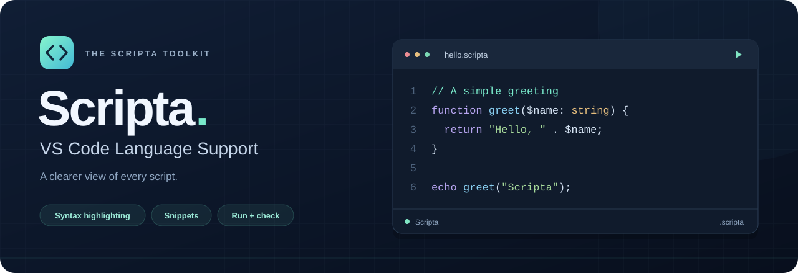

# Scripta VS Code Language Support

VS Code language support for [Scripta](https://github.com/trafficinc/scripta).
Open a `.scripta` file to select **Scripta** automatically. Extensionless scripts are
recognized by a `scripta` shebang or a first-line `<?scripta` tag. You can also select
Scripta from VS Code's language mode picker. The shorthand `.scta` extension,
legacy `<?scr` tag, and `scr` shebang remain supported. The `.scr` extension
is no longer associated with Scripta.

Includes syntax highlighting, line/block comment toggling, bracket matching,
auto-closing quotes and brackets, indentation, and region folding. Strings stay
literal: `$name` inside a string is not interpolation. Double-quoted and
single-quoted strings have different supported escapes, matching Scripta.

When Code Spell Checker is installed, the extension includes `scripta` in its
default accepted words. If you configure `cSpell.words` yourself, include
`scripta` in that list too, since explicit settings override extension defaults.

Snippets: `scripta`, `scriptamain` (also `scr`, `scrmain`), `fn`, `if`, `ifelse`, `foreach`, `foreachkv`, `for`,
`while`, `try`, `echo`, and `require`. Use **Insert Snippet** or completion to
insert one. The script snippets are intended for empty files.

## Install locally

To rebuild the package in `dist/`, run this from the project root (requires Python 3):

```sh
python3 scripts/package.py
```

This creates or replaces `dist/scripta-language-support-0.3.0.vsix`.

In VS Code, run **Extensions: Install from VSIX...** from the Command Palette
and choose `dist/scripta-language-support-0.3.0.vsix`. Open a `.scripta` file, or reopen
an existing one if its language mode was previously set manually.

## Run and check scripts

Install the `scripta` runtime and put it on PATH, or set **Scripta: Executable Path**
to its full path in VS Code Settings. For example:

```json
{
  "scripta.executablePath": "/path/to/scripta",
  "scripta.runArguments": ["--sample"],
  "scripta.checkOnSave": true
}
```

Open a Scripta file and use the play button, editor context menu, or Command
Palette command **Scripta: Run Scripta File**. The script runs in an integrated
terminal, which supports interactive input. Stop it with the task's terminate
button. Each `runArguments` item is passed literally as one script argument.
The working directory is the file's workspace folder, or its containing directory
when opened outside a workspace. Paths are passed directly to the process.

**Scripta: Check Scripta File** runs `scripta check` without executing the script and
shows errors as editor underlines and entries in Problems, with diagnostic codes
and help text. A successful check clears previous errors. Checks also run on
save by default; turn off `scripta.checkOnSave` to check manually. Diagnostics
clear when you edit, so they never refer to an older buffer. Checks stop after
10 seconds or 1 MiB of output. Open **Output → Scripta** for runtime setup errors
or unrecognized CLI output. Only the saved entry file is checked; `scripta check`
does not recursively check dependencies or perform full static type checking.

Run and Check save modified files first and offer Save As for an untitled
Scripta document. These features require a trusted workspace and files on disk;
remote workspaces use the runtime installed on the remote host. Highlighting
and snippets work without `scripta` and in Restricted Mode. IntelliSense
and debugging are not included.

## Format source code

Scripta files format automatically when saved. Use VS Code's **Format Document**
or **Format Selection** commands to format manually. Formatting requires a trusted
workspace and a Scripta runtime that supports `scripta fmt`, found on PATH or through
`scripta.executablePath`.

To turn automatic formatting off, open **Preferences: Configure Language Specific
Settings**, choose **Scripta**, and uncheck **Editor: Format On Save**. You can also
set this in your user or workspace `settings.json`:

```json
{
  "[scripta]": {
    "editor.formatOnSave": false
  }
}
```

Set it to `true` to enable it again. Manual formatting remains available when
format on save is disabled. If multiple formatters are installed for Scripta,
choose **Scripta Language Support** using **Format Document With… → Configure
Default Formatter**.

Formatting uses the runtime's PHP-like style with four-space indentation. It works
on the current buffer, including unsaved changes and untitled documents, using a
temporary copy. The original file is saved only through VS Code. Strings and
comments keep their contents, and existing line endings are preserved. Selection
formatting applies only whitespace changes fully inside the selected range; the
whole document must have valid syntax. Invalid syntax, missing runtime support,
or formatter failures leave the buffer unchanged; details appear in
**Output → Scripta Formatting**.

## Develop

With Node.js 22+ and npm:

```sh
npm install
npm test
npm run package
```

Open this folder in VS Code and press **F5** to launch an Extension Development
Host with `examples/highlighting.scripta`. Check colors in a light and dark theme,
comment toggling, quote/bracket completion, indentation, and snippet insertion.
The example can be checked and run using `scripta check examples/highlighting.scripta`
and `scripta examples/highlighting.scripta`.

Tests use VS Code's TextMate and Oniguruma engines to check actual token scopes,
including multiline state and escaped quotes. They also expand snippet defaults
and can validate them with the runtime when `SCRIPTA_BIN` is set to its executable (`SCR_BIN` remains supported).

For packaging without npm dependencies, Python 3 can create the local-install
VSIX with `python3 scripts/package.py`. Marketplace publishing is a separate step;
verify the publisher identity and repository URL before publishing.

An editor smoke test is available in `tests/vscode`. With an isolated VS Code
profile, set `SCRIPTA_BIN` and launch VS Code with `--extensionDevelopmentPath` set
to this repository and `--extensionTestsPath` set to `tests/vscode` (both absolute
paths). The test checks language recognition, actual diagnostics, saving, and
running a terminal task. Use a separate `--user-data-dir` and `--extensions-dir`
for this test; it temporarily changes that profile's Scripta settings.
